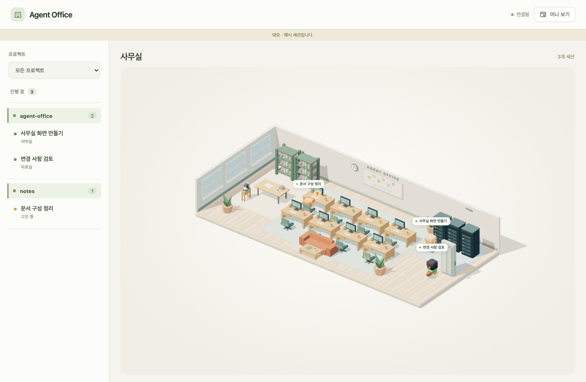

# Agent Office

Codex의 진행 중인 작업을 미니어처 사무실로 보여주는 macOS 앱입니다. **추가 모델 호출·모델 토큰 사용 없이** 로컬 기록으로 움직입니다.



**대상:** macOS 13 이상 · Apple Silicon

## 기능

- **실시간 사무실:** 프로젝트·세션 이름과 자료 읽기·명령 실행·답변/승인 대기 표시
- **세션 상세:** 현재 상태 설명, 누계 토큰, 이번 작업 시간
- **미니 보기:** 항상 위에 표시. 이 모드에서는 Dock에서 앱이 사라질 수 있음
- **사용량:** 계정의 5시간·주간 잔여 비율, 1분 갱신과 수동 새로고침

사무실 위에서 **스크롤 / ⌘+ / ⌘−**로 확대·축소하고 **⌘0**으로 초기화합니다. 완료된 세션은 숨깁니다.

## 실행

개발 환경: Node.js 22.12 이상, Rust stable, Xcode Command Line Tools.

```sh
npm ci
npm run desktop
```

배포본은 Releases의 ZIP을 풀어 `Agent Office.app`을 응용 프로그램 폴더로 옮깁니다. 현재는 **ad-hoc 서명만 제공**하므로 macOS 보안 경고가 나타날 수 있습니다.

빌드: `npm run desktop:build` · 배포 ZIP·체크섬: `npm run release:build`

## 데이터와 제약

세션 기록은 읽기 전용입니다. 계정 사용량 조회에만 로컬 인증 정보를 사용해 외부 요청을 보냅니다. 인증 정보와 대화는 저장하지 않습니다.

로컬에 기록된 작업만 표시하며, 기록 누락·형식 변경 시 상태가 정확하지 않을 수 있습니다. 세션 토큰 수와 요금제 사용률은 별개입니다.

- [개발·코드 컨벤션](CONTRIBUTING.md) · [AI 작업 지침](AGENTS.md)
- [배포](RELEASING.md) · [변경 기록](CHANGELOG.md)
- [데이터·보안](SECURITY.md) · [검증 결과](VALIDATION.md)

[MIT License](LICENSE). AgentRoom 기반 코드와 Kenney CC0 에셋의 출처는 [제3자 고지](THIRD_PARTY_NOTICES.md)에 있습니다.
